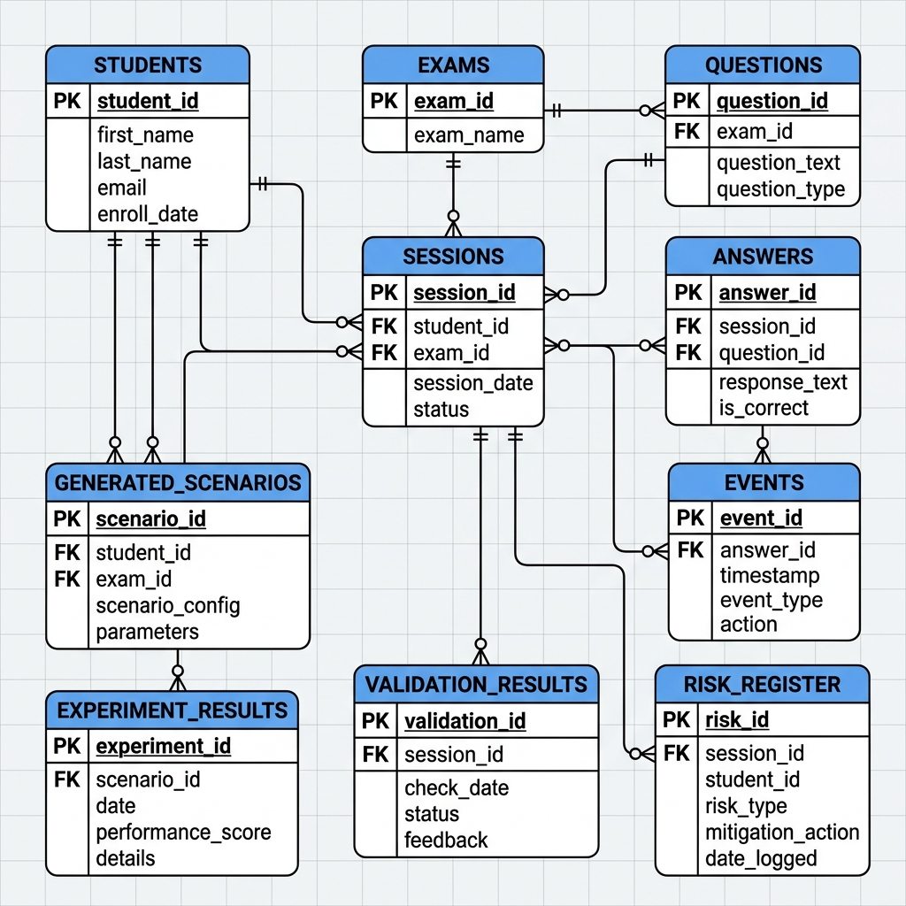

# Online Examination Platform – Review 3 Documentation

## Project Overview

This repository implements an **online examination platform** that can generate synthetic exam data, inject realistic failures, and evaluate the impact on exam integrity. The backend is built with **FastAPI**, **SQLAlchemy**, and **Pandas**, while the frontend (not covered here) provides a UI for instructors and students.

## Setup & Installation

```bash
# Clone the repository
git clone <repo-url>
cd Online-examination-platform-exposed-unusual-student-behaviour-main

# Create a virtual environment
python -m venv venv
source venv/bin/activate  # Windows: venv\Scripts\activate

# Install dependencies
pip install -r requirements.txt

# Initialise the database (SQLite in-memory for demo)
python -c "from backend.database.database import init_db; init_db()"

# Run the API server
uvicorn backend.main:app --reload
```

The API will be available at `http://127.0.0.1:8000`.

## API Reference

| Endpoint | Method | Request Schema | Response Schema | Description |
|----------|--------|----------------|----------------|-------------|
| `/health` | GET | – | `{ status, dataset_loaded, database_connected, version, timestamp }` | Health check.
| `/profile` | GET | – | Data profiling JSON | Generates a profile of the reference dataset.
| `/generate` | POST | `GenerateRequest` | Generation result JSON | Generate synthetic data (baseline or proposed).
| `/generate/baseline` | POST | `GenerateRequest` | Same as `/generate` with `generator="Baseline"` |
| `/validate/schema` | POST | – | Schema validation result |
| `/validate/referential` | POST | – | Referential integrity result |
| `/validate/distribution` | POST | – | Distribution similarity result |
| `/validate/privacy` | POST | – | Privacy audit result |
| `/scenarios` | GET | – | List of predefined behaviour profiles |
| `/simulation/run` | POST | `SimulationRequest` | Simulation outcome |
| `/events/replay` | POST | List of event dicts | Replay result |
| `/experiments/run` | POST | `ExperimentRequest` | Benchmark comparison |
| `/risk-register` | GET/POST | `RiskRegisterItem` (POST) | Risk items |
| `/reports` | GET | – | Full executive report |
| `/demo/run` | POST | – | 1‑click end‑to‑end demo |

*Full request/response schemas are defined in `backend/api/routes.py` using Pydantic models.*

## Database Schema

The relational schema is defined in `backend/database/models.py`. Below is a high‑level overview:

- **students** – stores student identifiers.
- **exams** – exam metadata.
- **questions** – exam questions linked to exams.
- **sessions** – each exam session for a student.
- **answers** – answers submitted per session.
- **events** – low‑level interaction events (login, view, submit, etc.).
- **generated_scenarios**, **experiment_results**, **validation_results**, **risk_register** – auxiliary tables for simulation, benchmarking, and risk tracking.



## Unit Testing Guide

The test suite resides in `backend/tests` and uses **pytest**.

```bash
# Run all tests with coverage
pytest -q --cov=backend
```

### Example Test
```python
import pytest
from fastapi.testclient import TestClient
from backend.main import app

client = TestClient(app)

def test_health_endpoint():
    response = client.get("/health")
    assert response.status_code == 200
    data = response.json()
    assert data["status"] == "ok"
    assert "timestamp" in data
```

Add more tests following this pattern for each endpoint, especially error cases (e.g., invalid payloads).

## Error Handling Strategies

- All endpoints raise `HTTPException` with appropriate status codes on failure.
- Validation errors from Pydantic automatically return `422 Unprocessable Entity`.
- Custom error boundaries are implemented in the service layer; they catch unexpected exceptions, log details, and return a generic `500 Internal Server Error` with a safe error message.

---

*This README is kept up‑to‑date for Review 3. Feel free to extend the API table or add more detailed diagrams as the project evolves.*
